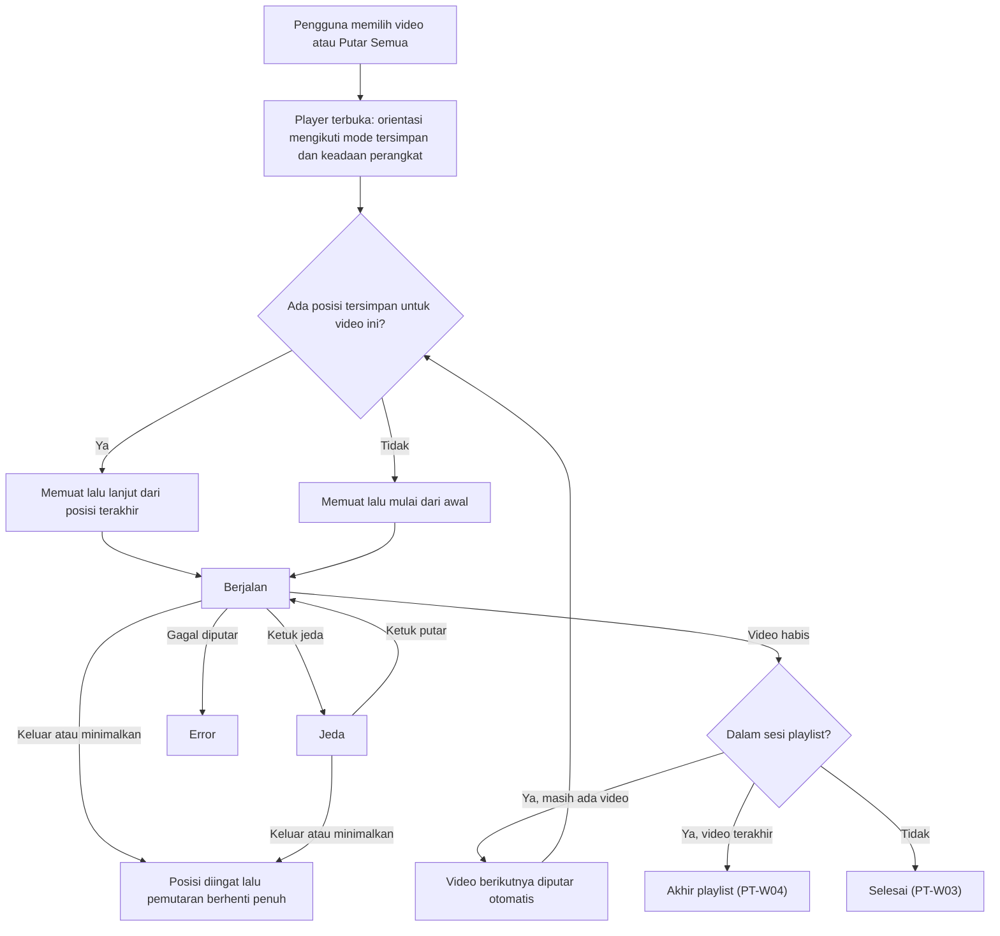
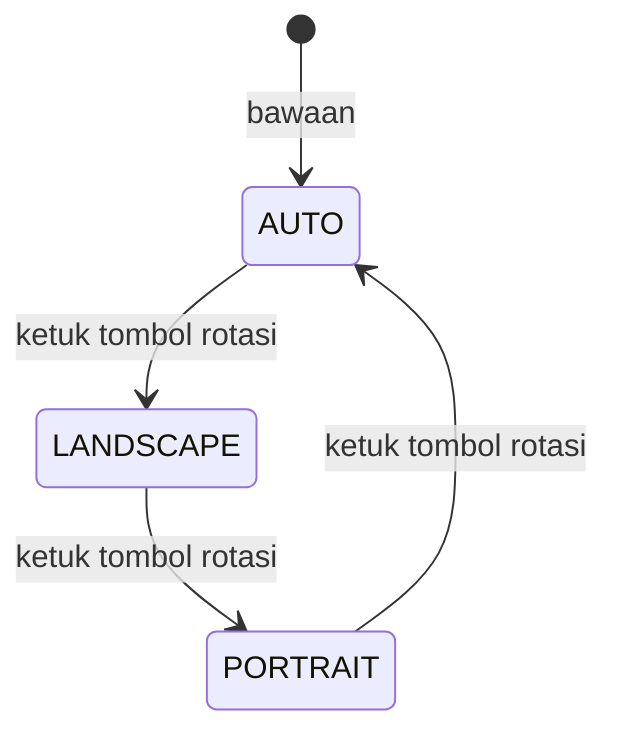
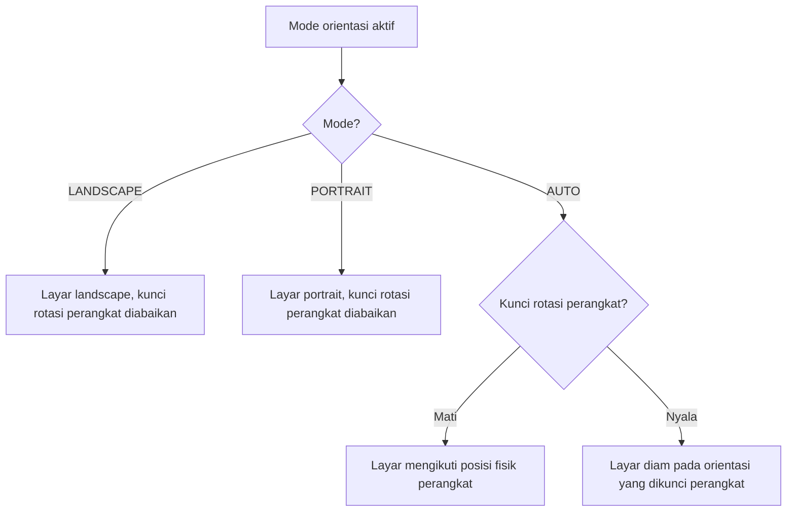

# Blueprint-Workflow.md — Alur Kerja AVP (Android Video Player)

> Dokumen alur kerja murni: **aktor, daftar layar, alur, dan state**. Tidak memuat teknologi, kode, penyimpanan teknis, setup, atau tahap pengerjaan. Sumber: PRD.md (utama) dan AVP_blueprint.md. Tampilan visual rinci ada di UI.md; dokumen ini hanya menjelaskan **apa yang terjadi dan kapan**.

## Daftar Isi

1. Cakupan & Cara Membaca
2. Aktor
3. Daftar Layar & Panel
4. Alur
5. State
6. Aturan Lintas Alur (Invarian)
7. Catatan & Pertanyaan Terbuka

---

## 1. Cakupan & Cara Membaca

- AVP: pemutar video **offline** untuk **satu pengguna**, memutar video lokal `.mp4` dan `.mkv` hardsub. Tidak ada jaringan, akun, atau pelacakan.
- Setiap alur diberi ID (A1, A2, …). Tanda **⚠PT-Wxx** menunjuk Pertanyaan Terbuka (§7).
- Rentang perangkat yang didukung ditetapkan produk (PRD §6). Perbedaan perilaku antar perangkat ditangani aplikasi, sehingga alur di sini sama bagi pengguna.

## 2. Aktor

| Aktor | Peran |
|---|---|
| **Pengguna** (pemilik perangkat) | Satu-satunya aktor manusia. Menjelajah, memutar, menyesuaikan, dan mengelola playlist |
| **Sistem Android** (aktor eksternal) | Pihak di luar aplikasi yang: memberikan atau menolak **izin akses video**; menyediakan **kunci rotasi perangkat** (nyala/mati) dan **posisi fisik perangkat** (tegak/miring); mengirim kejadian seperti aplikasi diminimalkan atau kembali |

Tidak ada aktor lain (tanpa admin, multi-user, atau layanan luar).

## 3. Daftar Layar & Panel

### 3.1 Layar

| ID | Layar | Tujuan | Pintu masuk | Pintu keluar |
|---|---|---|---|---|
| L1 | **Tanpa Izin** | Menjelaskan perlunya akses video dan meminta izin | Peluncuran tanpa izin; izin dicabut | Izin diberikan → L2 |
| L2 | **Beranda** (wadah 3 tab + bilah pencarian + pintu ke Kustomisasi) | Pusat navigasi | Peluncuran dengan izin; kembali dari L6/L7 | Pilih video → L6; menu → L7; keluar aplikasi |
| L2a | Tab **Video** | Daftar seluruh video lokal | Tab bawah | Ketuk video → L6; menu ⋮ → P1 |
| L2b | Tab **Folder** | Grid folder berisi video | Tab bawah | Ketuk folder → L3 |
| L2c | Tab **Daftar Putar** | Daftar playlist | Tab bawah | Ketuk playlist → L4; tombol tambah → P2 |
| L3 | **Daftar Video dalam Folder** | Video dalam satu folder | Ketuk folder di L2b | Ketuk video → L6; kembali → L2b |
| L4 | **Detail Playlist** | Isi, urutan, dan pemutaran satu playlist | Ketuk playlist di L2c | Putar Semua/ketuk entri → L6; kembali → L2c |
| L5 | **Pencarian** (mode di dalam Beranda) | Menyaring video berdasarkan nama file | Aktifkan pencarian | Ketuk hasil → L6; tutup pencarian → L2 |
| L6 | **Player** | Memutar video | Dari L2a/L3/L4/L5 | Keluar (kembali) → layar asal; minimalkan aplikasi |
| L7 | **Kustomisasi** (4 tab: **Judul**, **Tombol**, **Tema**, **Whitelist**) | Mengatur tampilan dan folder | Menu di L2 (⚠PT-W01: pintu dari L6) | Kembali → layar asal |

### 3.2 Panel/lapisan di atas layar

| ID | Panel | Muncul dari | Catatan |
|---|---|---|---|
| P1 | Menu ⋮ video (Ganti Nama, Properti, Tambah ke Playlist, Hapus dari Daftar) | Item video (L2a/L3) | ⚠PT-W08 |
| P2 | Input nama playlist (buat/ganti nama) | L2c, L4 | Bentuk belum ditetapkan |
| P3 | Pemilih playlist tujuan | "Tambah ke Playlist" di P1 | Bentuk belum ditetapkan |
| P4 | Pemilih kecepatan putar | Tombol kecepatan di L6 | Nilai belum ditetapkan |
| P5 | Label orientasi sesaat | Pergantian mode orientasi di L6 | Hilang sendiri |
| P6 | Konfirmasi capture (pesan singkat) | Hasil capture di L6 | Berhasil/gagal |
| P7 | Indikator gestur (kecerahan, volume, pratinjau seek, penanda ketuk dua kali) | Gestur di L6 | Sesaat |

## 4. Alur

### A1 — Peluncuran pertama & pemberian izin

**Utama (izin diberikan)**
1. Pengguna membuka aplikasi → Sistem Android belum memberi izin → tampil **L1**.
2. Pengguna menekan "Izinkan Akses" → Sistem Android menampilkan permintaan izin.
3. Pengguna **mengizinkan** → aplikasi memuat daftar video dan folder (keadaan *memuat*) → tampil **L2** dengan tab Video (keadaan *berisi* atau *kosong*).

**Alternatif: izin ditolak**
- Pengguna **menolak** → tetap di **L1** dengan penjelasan; tombol "Izinkan Akses" tetap bisa ditekan lagi. Aplikasi **tidak crash** dan tidak menampilkan daftar kosong tanpa penjelasan.
- Penolakan permanen, izin dicabut saat aplikasi berjalan, dan izin parsial: ⚠PT-W11.

**Peluncuran berikutnya**
- Izin sudah ada → langsung **L2** (memuat → berisi/kosong).

### A2 — Menjelajah & mencari video

1. Di **L2a**, daftar video tampil (anatomi di UI.md). Pengguna menggulir; thumbnail dimuat sambil menggulir.
2. Pengguna dapat berpindah tab (Video ↔ Folder ↔ Daftar Putar) kapan saja; konten tab menyesuaikan.
3. **Pencarian**: pengguna mengaktifkan bilah pencarian (L5) → mengetik → daftar tersaring berdasarkan **nama file** seiring pengetikan → hasil kosong menampilkan keadaan "tidak ada hasil" → menutup pencarian mengembalikan daftar penuh. Pencarian di tab selain Video: ⚠PT-W13.
4. Ketuk video → **A4**.

### A3 — Membuka folder

1. Di **L2b**, pengguna mengetuk kartu folder → **L3** menampilkan video di folder itu.
2. Ketuk video → **A4** (pemutaran satu video). Tombol kembali → L2b.
3. Folder yang tampil di L2b dipengaruhi aturan whitelist (A9).

### A4 — Memutar video

Aturan:
- Pemutaran **dimulai otomatis** setelah siap.
- Layar tetap menyala selama player aktif; tampilan immersive (bilah sistem tersembunyi).
- Tidak ada pemutaran di latar belakang: begitu player ditinggalkan, video **berhenti sepenuhnya**.
- Kontrol dasar: putar/jeda, sebelumnya/berikutnya, seek bar, kecepatan, kunci, rasio layar, rotasi, capture. **Sebelumnya/berikutnya di luar playlist**: ⚠PT-W02.
- **Kecepatan**: ketuk tombol kecepatan → P4 → pilih nilai → kecepatan baru berlaku seketika dan tetap saat orientasi berubah.
- **Rasio layar**: ketuk tombol rasio → bergantian fit ↔ fill.

### A5 — Melanjutkan tontonan (resume)

1. Video sedang diputar; pengguna **keluar dari player** atau **meminimalkan aplikasi** → posisi terakhir video itu **diingat aplikasi**.
2. Di lain waktu (termasuk setelah aplikasi dimulai ulang), pengguna membuka **video yang sama** → pemutaran **otomatis lanjut dari posisi terakhir**.
3. Video yang belum pernah diputar mulai dari awal.
4. Posisi diingat **per video**, tidak hilang karena pembaruan aplikasi.
5. Kembali ke aplikasi setelah diminimalkan dan setelah video selesai ditonton: ⚠PT-W01, ⚠PT-W03.

### A6 — Memakai gestur (di L6)

| Gestur | Zona | Hasil |
|---|---|---|
| Seret vertikal | Sepertiga kiri | Mengubah kecerahan; indikator ikon + persentase |
| Seret vertikal | Sepertiga kanan | Mengubah volume; indikator ikon + persentase |
| Seret horizontal | Tengah | Menampilkan **pratinjau posisi** selama jari bergerak; **seek sungguhan baru terjadi saat jari diangkat** |
| Ketuk dua kali | Kiri / kanan | Mundur / maju sebesar langkah seek (bawaan 10 detik) dengan penanda animasi di zona yang diketuk |
| Ketuk satu kali | Mana saja | Menampilkan/menyembunyikan kontrol |

- **Alternatif: kunci aktif**: semua gestur dan tombol diabaikan kecuali membuka kunci (⚠PT-W12, ⚠PT-W15).
- Langkah seek "dapat diatur", tetapi pintu pengaturannya tidak ada di 4 tab Kustomisasi: ⚠PT-W14.

### A7 — Mengubah orientasi

**Prinsip:** orientasi player adalah **keadaan yang berubah saat aplikasi berjalan**, dengan tiga mode: **AUTO**, **LANDSCAPE**, **PORTRAIT**. Tidak pernah dikunci landscape secara permanen.

**Siklus tombol rotasi** (satu ketukan = satu langkah):

**Penentuan orientasi layar:**

**Matriks lengkap: kunci rotasi perangkat × mode aplikasi → hasil tampilan**

| Kunci rotasi perangkat | Mode aplikasi | Perangkat tegak | Perangkat dimiringkan |
|---|---|---|---|
| **Mati** | AUTO | Portrait | Landscape (layar berputar) |
| **Mati** | LANDSCAPE | Landscape | Landscape |
| **Mati** | PORTRAIT | Portrait | Portrait |
| **Nyala** | AUTO | Diam di orientasi terkunci perangkat | Diam (tidak berputar) |
| **Nyala** | LANDSCAPE | Landscape (mengalahkan kunci perangkat) | Landscape |
| **Nyala** | PORTRAIT | Portrait (mengalahkan kunci perangkat) | Portrait |

**Hasil ketukan tombol rotasi dari tiap keadaan (acuan uji penerimaan PRD):**

| Keadaan awal | Aksi | Hasil |
|---|---|---|
| AUTO, kunci rotasi mati, HP portrait | HP dimiringkan | Layar menjadi landscape; video lanjut tanpa jeda/restart |
| AUTO, kunci rotasi nyala | HP dimiringkan | Layar tidak berubah; video lanjut |
| Kunci rotasi nyala, layar portrait | Ketuk tombol rotasi 1× | Mode **LANDSCAPE**; layar berputar ke landscape |
| LANDSCAPE | Ketuk tombol rotasi 1× | Mode **PORTRAIT**; layar berputar ke portrait |
| PORTRAIT | Ketuk tombol rotasi 1× | Kembali **AUTO**; layar mengikuti perangkat lagi |

**Alur khusus: rotasi perangkat terkunci, pengguna memakai tombol rotasi**
1. Pengguna menonton dengan kunci rotasi nyala; layar portrait dan **tidak berputar** meski HP dimiringkan (perilaku benar dalam mode AUTO).
2. Pengguna mengetuk tombol rotasi → mode **LANDSCAPE** → layar berputar ke landscape (mengalahkan kunci perangkat); P5 menampilkan "Landscape".
3. Ketukan berikutnya → **PORTRAIT** (P5 "Portrait") → layar portrait.
4. Ketukan berikutnya → **AUTO** (P5 "Otomatis") → kunci buatan aplikasi dilepas; layar kembali mengikuti kunci perangkat (diam).
5. Petunjuk "rotasi HP terkunci, ketuk tombol rotasi" bersifat opsional: ⚠PT-W16.

**Aturan yang selalu berlaku saat orientasi berubah (dengan cara apa pun):**
- Pemutaran **tidak dimulai ulang**: posisi, status putar/jeda, dan kecepatan tetap; hanya tata letak yang menyesuaikan.
- **Portrait**: video tampil dengan rasio aslinya (letterbox) dan kontrol tetap terjangkau. **Landscape**: video memenuhi layar.
- Mode orientasi terakhir **diingat** dan dipakai saat player dibuka lagi; membuka player **tidak memaksa** orientasi di luar mode tersimpan dan keadaan perangkat saat itu.
- Ikon/label tombol rotasi selalu menunjukkan mode aktif.
- Perubahan kunci rotasi perangkat saat player terbuka diperlakukan sebagai kejadian perangkat yang langsung memengaruhi mode AUTO (mode LANDSCAPE/PORTRAIT tidak terpengaruh).

### A8 — Menangkap frame

1. Pengguna menekan tombol capture di L6.
2. Aplikasi mengambil **frame dari video itu sendiri** pada posisi saat itu (bukan tangkapan layar): resolusi asli video, tanpa overlay antarmuka dan tanpa pita letterbox.
3. **Berhasil** → gambar tersimpan di galeri perangkat (album khusus AVP) dan P6 menampilkan konfirmasi visual.
4. **Gagal** → P6 menampilkan pesan gagal (redaksi: ⚠PT-W19).
5. Pemutaran tidak terganggu oleh capture.

### A9 — Mengubah kustomisasi dan dampak langsungnya

Pintu masuk: menu di Beranda (L2) → **L7**. Setiap perubahan **langsung tersimpan** dan tetap berlaku setelah aplikasi dimulai ulang.

| Tab | Perubahan pengguna | Dampak langsung |
|---|---|---|
| **Judul** | Ukuran (10–22sp), 1/2 baris, tebal, marquee, warna | Pratinjau di layar ikut berubah seketika; judul di player memakai gaya baru pada pemutaran berikutnya |
| **Tombol** | Ketuk slot pertama (disorot) → ketuk slot kedua → dua tombol **bertukar posisi**; "Reset ke Default" | Pratinjau tata letak ikut berubah seketika; susunan tombol di player berubah |
| **Tema** | Mode Sistem/Terang/Gelap/AMOLED; warna aksen (preset atau HEX); Dynamic Color (hanya pada perangkat yang mendukung) | Seluruh aplikasi berganti tampilan **instan**; AMOLED = hitam murni |
| **Whitelist** | Mode "semua folder" ↔ "hanya folder pilihan"; centang folder | Pada mode kedua, tab Folder hanya menampilkan folder tercentang; mode pertama menampilkan semua kembali |

Alternatif: ketuk slot yang sama dua kali → seleksi dibatalkan (perilaku rinci: ⚠PT-W20).

### A10 — Mengelola playlist

1. **Buat**: di L2c, tekan tombol tambah → P2 (nama) → playlist baru muncul di daftar. Nama kosong/duplikat: ⚠PT-W18.
2. **Tambah video**: di item video tekan ⋮ → "Tambah ke Playlist" → P3 → pilih playlist → video masuk di urutan paling akhir.
3. **Hapus video dari playlist**: tersedia di L4 (pemicu tampilan: ⚠PT-W09). Fitur "urungkan" **tidak ada** di sumber (⚠PT-W05).
4. **Ubah urutan**: di L4, seret entri → urutan baru **tersimpan**.
5. **Ganti nama / hapus playlist**: sesuai PRD; pemicu tampilan: ⚠PT-W09.
6. **Putar Semua**: di L4 → player memutar entri pertama sebagai **sesi playlist**.
7. **Lanjut otomatis**: saat video habis dan masih ada entri berikutnya → video berikutnya diputar otomatis (dengan aturan resume per video).
8. **Akhir playlist**: saat video terakhir habis → ⚠PT-W04.
9. **Shuffle** ada di L4 menurut blueprint, tidak di PRD (⚠PT-W06). **Ketuk entri** tertentu: ⚠PT-W07. **File entri hilang/tak bisa diputar**: ⚠PT-W10.

### A11 — Menu ⋮ video

- **Tambah ke Playlist** → A10 langkah 2.
- **Ganti Nama**, **Properti**, **Hapus dari Daftar** → semantik belum ditetapkan (⚠PT-W08).

### A12 — Keluar dari player

1. Pengguna menekan tombol kembali (atau tombol kembali sistem) di L6.
2. Posisi video **diingat**, pemutaran **berhenti penuh**, dan pengguna kembali ke **layar asal** (L2a/L3/L4/L5).
3. Alternatif: pengguna menekan Home/meminimalkan atau berpindah ke aplikasi lain → posisi diingat dan pemutaran berhenti penuh (kembali ke aplikasi: ⚠PT-W01).

## 5. State

### 5.1 State tiap layar

| Layar | Memuat | Kosong | Berisi | Error | Tanpa izin |
|---|---|---|---|---|---|
| L2a Video | ✔ (placeholder) | ✔ | ✔ | ✔ | → L1 |
| L2b Folder | ✔ | ✔ (termasuk whitelist tak meloloskan folder) | ✔ | ✔ | → L1 |
| L2c Daftar Putar | ✔ | ✔ | ✔ | ✔ | — (tidak butuh izin) |
| L3 Folder | ✔ | ✔ | ✔ | ✔ | → L1 |
| L4 Detail Playlist | ✔ | ✔ (playlist tanpa video) | ✔ | ✔ | — |
| L5 Pencarian | — | ✔ (tidak ada hasil) | ✔ | — | — |
| L6 Player | ✔ (lihat §5.2) | — | ✔ | ✔ | — |
| L7 Kustomisasi | ✔ | — | ✔ | — | — |
| L1 | Layar ini **adalah** keadaan "tanpa izin" | | | | |

**Transisi state layar daftar**

| Dari | Ke | Pemicu |
|---|---|---|
| (awal) | Memuat | Layar dibuka dan izin ada |
| Memuat | Berisi | Data ditemukan |
| Memuat | Kosong | Tidak ada data |
| Memuat | Error | Pemuatan gagal |
| Error | Memuat | Pengguna menekan "Coba Lagi" |
| Berisi/Kosong | Memuat | Pengguna kembali ke layar atau izin baru diberikan |
| Berisi | Kosong | Whitelist/pencarian menyaring habis |
| Mana pun | Tanpa izin (L1) | Kejadian perangkat: izin tidak ada/dicabut |
| Tanpa izin (L1) | Memuat | Pengguna memberi izin lewat Sistem Android |

### 5.2 State pemutaran (L6)

| State | Arti |
|---|---|
| **Belum mulai** | Player baru dibuka, video belum dimuat |
| **Memuat** | Menyiapkan video atau menunggu data (mis. setelah seek) |
| **Berjalan** | Video diputar |
| **Jeda** | Video dihentikan sementara |
| **Selesai** | Video mencapai akhir |
| **Error** | Video tidak dapat diputar |

| Dari | Ke | Pemicu |
|---|---|---|
| Belum mulai | Memuat | Player dibuka (aksi pengguna memilih video) |
| Memuat | Berjalan | Video siap (kejadian pemutaran) |
| Memuat | Error | File gagal dibuka (kejadian pemutaran) |
| Berjalan | Jeda | Pengguna menekan jeda |
| Jeda | Berjalan | Pengguna menekan putar |
| Berjalan | Memuat | Pengguna melakukan seek dan data belum siap |
| Memuat | Berjalan | Data siap setelah seek |
| Berjalan | Selesai | Video mencapai akhir |
| Selesai | Memuat | Video berikutnya dalam sesi playlist dimulai otomatis |
| Selesai | (tetap) | Video tunggal/akhir playlist: ⚠PT-W03, ⚠PT-W04 |
| Berjalan/Jeda/Memuat | Belum mulai (ditutup) | Pengguna keluar dari player atau aplikasi diminimalkan (kejadian perangkat) |
| Error | Memuat | Pengguna memilih video lain |

Perubahan orientasi **tidak** mengubah state pemutaran dan tidak menimbulkan transisi di atas.

### 5.3 State tampilan kontrol

| State | Arti |
|---|---|
| **Tampil** | Overlay kontrol terlihat |
| **Tersembunyi** | Overlay tidak terlihat; hanya video |
| **Terkunci** | Gestur dan tombol dibekukan; hanya aksi buka kunci yang berfungsi |

| Dari | Ke | Pemicu |
|---|---|---|
| Tampil | Tersembunyi | ±3 detik tanpa interaksi **saat Berjalan** (kejadian waktu) |
| Tampil | Tersembunyi | Pengguna mengetuk layar |
| Tersembunyi | Tampil | Pengguna mengetuk layar |
| Tersembunyi | Tampil | Video masuk Jeda (kontrol dipaksa tampil) |
| Tampil | Tampil (timer ulang) | Interaksi pengguna apa pun |
| Tampil | Terkunci | Pengguna menekan tombol kunci |
| Terkunci | Tampil / Tersembunyi | Pengguna menekan tombol buka kunci: ⚠PT-W12 |

Timer sembunyi tidak berjalan saat **Jeda**.

### 5.4 State mode orientasi

| State | Arti |
|---|---|
| **AUTO** (bawaan) | Layar mengikuti perangkat dan kunci rotasinya |
| **LANDSCAPE** | Dipaksa landscape |
| **PORTRAIT** | Dipaksa portrait |

| Dari | Ke | Pemicu |
|---|---|---|
| (belum ada pilihan) | AUTO | Pertama kali player dipakai |
| AUTO | LANDSCAPE | Pengguna mengetuk tombol rotasi |
| LANDSCAPE | PORTRAIT | Pengguna mengetuk tombol rotasi |
| PORTRAIT | AUTO | Pengguna mengetuk tombol rotasi |
| Mode apa pun | (sama, tersimpan) | Setiap pergantian mode diingat; dipakai pada pembukaan player berikutnya |
| AUTO | (orientasi layar berubah) | Kejadian perangkat: HP dimiringkan **dan** kunci rotasi perangkat mati |
| AUTO | (orientasi layar tetap) | Kejadian perangkat: HP dimiringkan **dan** kunci rotasi perangkat nyala |

Orientasi layar yang tampil adalah turunan dari **mode + kunci rotasi perangkat + posisi fisik** (matriks di A7).

### 5.5 State sesi playlist

| State | Arti |
|---|---|
| **Tanpa sesi** | Memutar satu video biasa |
| **Sesi aktif (entri ke-i dari N)** | Sedang memutar playlist berurutan |
| **Sesi berakhir** | Entri terakhir selesai (perilaku lanjutan: ⚠PT-W04) |

| Dari | Ke | Pemicu |
|---|---|---|
| Tanpa sesi | Sesi aktif (i = 1) | Pengguna menekan Putar Semua |
| Tanpa sesi | Sesi aktif (i = k) | Pengguna mengetuk entri ke-k: ⚠PT-W07 |
| Sesi aktif (i) | Sesi aktif (i+1) | Video habis dan i < N (kejadian pemutaran) |
| Sesi aktif (i) | Sesi aktif (i±1) | Pengguna menekan berikutnya/sebelumnya |
| Sesi aktif (N) | Sesi berakhir | Video terakhir habis |
| Sesi aktif/berakhir | Tanpa sesi | Pengguna keluar dari player |

### 5.6 State izin (aktor Sistem Android)

| State | Pemicu perubahan |
|---|---|
| Belum diminta → Diberikan | Pengguna mengizinkan |
| Belum diminta → Ditolak | Pengguna menolak |
| Ditolak → Diberikan | Pengguna menekan "Izinkan Akses" lagi dan mengizinkan |
| Diberikan → Dicabut | Pengguna mencabut izin lewat pengaturan perangkat: ⚠PT-W11 |

## 6. Aturan Lintas Alur (Invarian)

1. Perputaran orientasi tidak pernah memulai ulang pemutaran.
2. Posisi terakhir tiap video selalu diingat saat player ditinggalkan; membuka ulang video yang sama selalu melanjutkan.
3. Video berhenti sepenuhnya begitu player ditinggalkan; tidak ada pemutaran latar.
4. Tidak ada interaksi jaringan; semua data hanya di perangkat.
5. Keadaan memuat, kosong, dan tanpa izin selalu berupa layar yang jelas; aplikasi tidak crash di keadaan itu.
6. Pembaruan aplikasi tidak menghapus posisi putar, playlist, atau pengaturan.

## 7. Catatan & Pertanyaan Terbuka

**Catatan atas sumber**
- Tidak ada pertentangan PRD–blueprint yang mengubah alur di sini. Pertentangan visual (label tab, posisi tombol, posisi ukuran file) dan hal-hal dari referensi gaya dicatat di UI.md §11.
- PRD menyebut hasil capture di galeri; dokumen ini mengikuti PRD dan tidak menjelaskan mekanismenya.

**Celah (tidak ditebak; butuh keputusan pemilik)**

- **PT-W01** — Kembali ke aplikasi setelah diminimalkan, atau kembali ke player dari Kustomisasi: blueprint mengizinkan Kustomisasi dibuka dari player (PRD tidak), padahal video berhenti penuh begitu player ditinggalkan. Belum jelas apakah pengguna kembali ke player yang melanjutkan dari posisi tersimpan, atau ke layar asal.
- **PT-W02** — Perilaku tombol sebelumnya/berikutnya saat memutar satu video di luar playlist (dinonaktifkan? mengikuti urutan daftar/folder?).
- **PT-W03** — Saat video tunggal selesai: apa yang tampil/terjadi (ulang, diam di akhir, kembali ke layar asal)? Juga apakah posisi tersimpan setelah selesai di-reset sehingga pemutaran berikutnya mulai dari awal.
- **PT-W04** — Akhir playlist: blueprint menyebut "end screen atau kembali ke Beranda" tanpa memilih.
- **PT-W05** — Fitur "urungkan" pada pengelolaan playlist tidak ada di PRD maupun blueprint; yang ada adalah hapus video dari playlist. Dokumen ini memakai penafsiran "hapus entri" sampai ada penjelasan.
- **PT-W06** — Shuffle ada di blueprint tetapi tidak di PRD; perilakunya (acak sekali, atau acak terus) tidak ditetapkan.
- **PT-W07** — Apakah mengetuk satu entri di detail playlist memulai sesi dari entri itu.
- **PT-W08** — Semantik "Ganti Nama" (nama file asli atau hanya nama tampilan?), "Properti" (isi), dan "Hapus dari Daftar" (hanya disembunyikan dari daftar atau lainnya; bagaimana dipulihkan).
- **PT-W09** — Pemicu tampilan untuk hapus video dari playlist, hapus playlist, dan ganti nama playlist tidak dirinci.
- **PT-W10** — Entri playlist/video yang file-nya sudah tidak ada atau tidak dapat diputar.
- **PT-W11** — Izin ditolak permanen (tidak bisa diminta lagi), izin dicabut saat aplikasi berjalan, dan izin parsial: tampilan/aksi yang tepat tidak dirinci.
- **PT-W12** — Setelah dibuka kunci, apakah kontrol Tampil atau Tersembunyi; dan bagaimana ikon kunci tetap terjangkau saat Terkunci dengan kontrol tersembunyi (blueprint: abaikan semua gestur kecuali ikon kunci).
- **PT-W13** — Cakupan pencarian: hanya tab Video, atau juga di tab/folder lain.
- **PT-W14** — Langkah seek (bawaan 10 detik) disebut dapat diatur, tetapi tidak ada tab Kustomisasi untuknya.
- **PT-W15** — Tombol rotasi saat kontrol terkunci: PRD menyatakan kunci membekukan gestur dan tombol, sehingga alur ini mengasumsikan tombol rotasi ikut dibekukan; konfirmasi diperlukan.
- **PT-W16** — Petunjuk "rotasi HP terkunci" opsional di blueprint, tidak ada di PRD.
- **PT-W17** — Beranda dan Kustomisasi: blueprint menetapkan portrait; PRD tidak menyebut. Diikuti blueprint (tidak bertentangan dengan keputusan terkunci).
- **PT-W18** — Nama playlist kosong atau kembar.
- **PT-W19** — Redaksi pesan saat capture gagal.
- **PT-W20** — Perilaku mengetuk slot yang sama dua kali pada editor tombol (pembatalan seleksi tidak disebut sumber).
